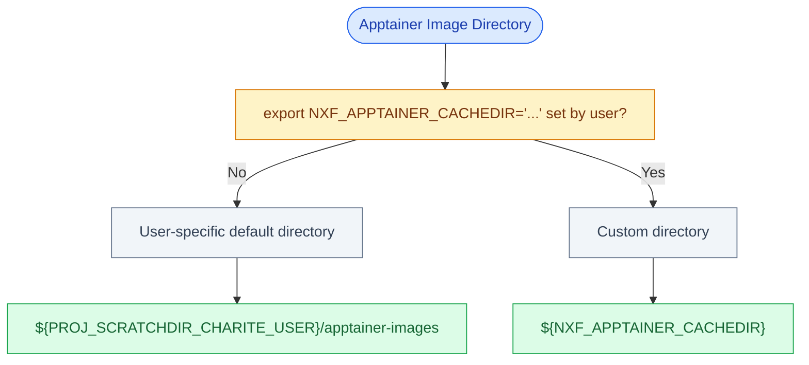
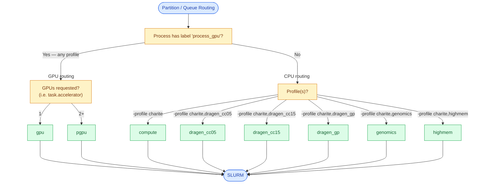

# nf-core/configs: Charité Configuration

This page documents the `charite` Nextflow profile for running Nextflow and nf-core pipelines on the Charité HPC. See the full configuration at [`conf/charite.config`](../conf/charite.config). For general HPC information, see [Charité Science IT](https://www.charite.de/en/research/research_support_services/research_infrastructure/science_it/).

> Official Contact: Scientific Computing, GB IT, Charité - sc-hpc-helpdesk@charite.de

## Table of Contents

- [Contributors and Acknowledgments](#contributors-and-acknowledgments)
- [1. Quick Overview and Usage Examples](#1-quick-overview-and-usage-examples)
- [2. Requesting Charité HPC Access](#2-requesting-charité-hpc-access)
- [3. Environment Setup](#3-environment-setup)
  - [3.1. Global Utility Variables](#31-global-utility-variables)
  - [3.2. Apptainer-specific Variables](#32-apptainer-specific-variables)
  - [3.3. Nextflow-specific Variables](#33-nextflow-specific-variables)
  - [3.4. Nextflow Strict Syntax](#34-nextflow-strict-syntax)
  - [3.5. Shared Nextflow Conda Environment](#35-shared-nextflow-conda-environment)
- [4. Running Nextflow Workflows on the Charité HPC](#4-running-nextflow-workflows-on-the-charité-hpc)
  - [Option 1: Interactive Session](#option-1-interactive-session)
  - [Option 2: Batch Script](#option-2-batch-script)
- [5. Job Assignment Logic and GPU Acceleration](#5-job-assignment-logic-and-gpu-acceleration)
- [6. More Practical Examples](#6-more-practical-examples)
- [7. Known Limitations and Issues](#7-known-limitations-and-issues)

## Contributors and Acknowledgments

- Developer: Wassim Salam - BIH/MDC Genomics Platform Data Management Team
- Maintainers: Magnus Hagdorn & Andreas Reppas - Scientific Computing HPC Team

[@wassimsalam01](https://github.com/wassimsalam01) thanks the following individuals for their support and guidance in developing the profile:

- Scientific Computing HPC Team ([@ScientificComputingCharite](https://github.com/ScientificComputingCharite))
    - Magnus Hagdorn ([@mhagdorn](https://github.com/mhagdorn))
    - Andreas Reppas ([@areppas](https://github.com/areppas))
- BIH/MDC Genomics Platform Data Management Team ([@BIH-MDC-Genomics-Platform](https://github.com/BIH-MDC-Genomics-Platform))
    - Marten Jäger ([@martenj](https://github.com/martenj))
    - Cornelius Fischer ([@cofischer](https://github.com/cofischer))
    - Namuun Battur ([@NmnBttr](https://github.com/NmnBttr))

## 1. Quick Overview and Usage Examples

- **Scheduler**: SLURM
- **Container Engine**: Apptainer
- **Default QOS**: `normal`
- **Default Queue**: `compute`
- **Resource Limits of Default Queue**:
  - Maximum CPUs: 192 cores
  - Maximum memory: 1TB
  - Maximum walltime: 2 days
- **Additional Queues**: `dragen_cc05`,`dragen_cc15`,`dragen_gp`,`genomics`,`highmem`
- **GPU Queues**: `gpu`,`pgpu`

See [Job Assignment Logic and GPU Acceleration](#5-job-assignment-logic-and-gpu-acceleration) for more info.

- **Usage Examples**:

```
# nf-core Pipeline
nextflow run nf-core/<pipeline-name> -profile charite ...
```

```
# Test nf-core Demo Pipeline (small-scale workflow)
# Specifying '-profile test' uses dummy data provided by nf-core for that particular pipeline
nextflow run nf-core/demo -profile test,charite --outdir results/demo-test
```

For the sake of simplicity, this documentation will assume usage of nf-core pipelines. To use this config with a custom Nextflow workflow, see the following links for more info:
- [Using nf-core/configs outside nf-core](https://nf-co.re/docs/developing/institutional-profiles/outside-nf-core)
- [Create a Pipeline with nf-core CLI](https://nf-co.re/docs/nf-core-tools/cli/pipelines/create) (nf-core CLI already available within [Shared Nextflow Conda Environment](#36-shared-nextflow-conda-environment))

## 2. Requesting Charité HPC Access

The Charité internal user documentation/wiki requires a Charité GitLab account. To request access:
1. Email sc-hpc-helpdesk@charite.de to request access to the Charité HPC. This initiates the onboarding process.
2. If you do not have access to [git.bihealth.org](https://git.bihealth.org/), contact health-data@charite.de to request GitLab access for the [Charité HPC User Documentation and Onboarding Guide](https://git.bihealth.org/charite-sc-public/sc-wiki/-/wikis/home).

## 3. Environment Setup

> [!NOTE]
> In order for the config to work as intended, some environment variables must first be exported before running any workflow. This section provides a detailed overview of those variables.
>
> A complete practical example is later provided in the next section, which integrates the exporting of the variables explained together with a run of a nf-core pipeline.
>
> [**Click here to skip ahead to 'Running Nextflow Workflows on the Charité HPC'**](#4-running-nextflow-workflows-on-the-charité-hpc)

### 3.1. Global Utility Variables

The Charité HPC profile uses project-specific scratch storage for Nextflow and Apptainer cache and temporary files whenever available. Storage paths are determined automatically based on the `PROJ_ABBR` environment variable:

- **If `PROJ_ABBR` is non-empty:** `PROJ_SCRATCHDIR_CHARITE_USER` is set to `/sc-scratch/sc-scratch-${PROJ_ABBR}`.
- **If `PROJ_ABBR` is empty:** `PROJ_SCRATCHDIR_CHARITE_USER` falls back to `${HOME}`, which has a **100 GB storage quota**.

The profile requires `PROJ_SCRATCHDIR_CHARITE_USER` to be defined and will fail if it is missing.

**Using project scratch storage is strongly recommended**, particularly for large pipelines, as Apptainer caches and Nextflow working directories can quickly exhaust the home-directory quota.

For more information on managing project and scratch storage, refer to the Charité HPC documentation:

- **Existing project members:** [How to access project and scratch directories](https://git.bihealth.org/charite-sc-public/sc-wiki/-/wikis/Resources/HOWTOs/how-to-access-project-and-scratch-directories)
- **Users without an assigned project:** [How to apply for project and scratch directories](https://git.bihealth.org/charite-sc-public/sc-wiki/-/wikis/Resources/HOWTOs/how-to-apply-for-project-and-scratch-directories)
- **Project administrators:** [How to manage project and scratch directories](https://git.bihealth.org/charite-sc-public/sc-wiki/-/wikis/Resources/HOWTOs/how-to-manage-project-and-scratch-directories)

```bash
# Project abbreviation (leave empty if you don't have one)
export PROJ_ABBR=""
if [[ -n "${PROJ_ABBR}" ]]; then
    export PROJ_SCRATCHDIR_CHARITE="/sc-scratch/sc-scratch-${PROJ_ABBR}"
    # Validate project scratch directory
    if [[ ! -d "${PROJ_SCRATCHDIR_CHARITE}" || ! -x "${PROJ_SCRATCHDIR_CHARITE}" ]]; then
        echo "[ERROR] Project scratch directory does not exist or is inaccessible: ${PROJ_SCRATCHDIR_CHARITE}"
        echo "[ERROR] Please verify your PROJ_ABBR ('${PROJ_ABBR}') and project access."
        exit 1
    fi
    export PROJ_SCRATCHDIR_CHARITE_USER="${PROJ_SCRATCHDIR_CHARITE}/${USER}"
else
    export PROJ_SCRATCHDIR_CHARITE_USER="${HOME}"
fi
# Fail-safe: ensure the required environment variable is not empty
if [[ -z "${PROJ_SCRATCHDIR_CHARITE_USER:-}" ]]; then
    echo "[ERROR] PROJ_SCRATCHDIR_CHARITE_USER is not set or is empty."
    exit 1
fi
```

### 3.2. Apptainer-specific Variables

| Variable                                                           | Purpose                                                                 | Value                                              |
| :---------------------------------------------------------------:  | :---------------------------------------------------------------------: | :------------------------------------------------: |
| `APPTAINER_CACHEDIR`                                               | Cache used internally by Apptainer when downloading and building images | `${PROJ_SCRATCHDIR_CHARITE_USER}/.apptainer`       |
| `APPTAINER_TMPDIR`                                                 | Temporary files generated during image creation                         | `${PROJ_SCRATCHDIR_CHARITE_USER}/.apptainer/tmp`   |
| `NXF_APPTAINER_CACHEDIR` (Nextflow equivalent `apptainer.cacheDir`)| Location of built Apptainer images                                      | `${PROJ_SCRATCHDIR_CHARITE_USER}/apptainer-images` |

Apptainer is readily available on Charité HPC compute nodes and does not require loading a module.

The configuration distinguishes between **Apptainer's internal cache and temporary files** and **Nextflow's cached container images**. These are stored separately to allow users to customize image storage without affecting Apptainer's internal operations.

#### Apptainer Cache and Temporary Files

The following environment variables define where Apptainer stores its internal cache and temporary files:


```bash
# Apptainer cache and temporary files (user-specific)
export APPTAINER_CACHEDIR="${PROJ_SCRATCHDIR_CHARITE_USER}/.apptainer"
export APPTAINER_TMPDIR="${PROJ_SCRATCHDIR_CHARITE_USER}/.apptainer/tmp"
mkdir -p "${APPTAINER_TMPDIR}"
```

#### Apptainer Image Cache

The location of built Apptainer container images is managed through through `NXF_APPTAINER_CACHEDIR` and `apptainer.cacheDir`.

```groovy
apptainer {
    // ...
    cacheDir = System.getenv("NXF_APPTAINER_CACHEDIR") ?: "${params.proj_scratchdir_charite_user}/apptainer-images"
    // ...
}
```

By default, container images are stored in the following **user-specific directory**: `${PROJ_SCRATCHDIR_CHARITE_USER}/apptainer-images`

The resulting default structure looks like this:

```bash
/sc-scratch/sc-scratch-${PROJ_ABBR}/
├── user1/
│   ├── .apptainer/
│   │   ├── cache/
│   │   └── tmp/
│   └── apptainer-images/
└── user2/
│   ├── .apptainer/
│   │   ├── cache/
│   │   └── tmp/
│   └── apptainer-images/
...
```

Users can optionally override this location like so:

```bash
# Adjust path as needed, this is just an example
export NXF_APPTAINER_CACHEDIR="${PROJ_SCRATCHDIR_CHARITE}/apptainer-images"
```

For projects with multiple collaborators, container images can be stored in a shared project directory rather than duplicated in each user's scratch directory. This allows collaborators to reuse already downloaded images, reducing redundant downloads and storage consumption.

```bash
/sc-scratch/sc-scratch-${PROJ_ABBR}/
├── apptainer-images/             # Shared container images (optional)
├── user1/
│   └── .apptainer/
│       ├── cache/
│       └── tmp/
└── user2/
│   └── .apptainer/
│       ├── cache/
│       └── tmp/
...
```

**Note:** Shared image directories require appropriate read/write permissions. Collaborators should coordinate access and avoid modifying or deleting images that others may be using. Please discuss this with your team.

The following diagram illustrates how Nextflow determines where to store container images:



### 3.3. Nextflow-specific Variables

The following environment variables configure Nextflow's home, cache, and temporary directories. By default, these are stored under `${PROJ_SCRATCHDIR_CHARITE_USER}/.nextflow`, keeping Nextflow-generated files outside the limited home directory whenever project scratch space is available.

| Variable        | Purpose                                                                                  | Value                                        |
| :-------------: | :-------------------------------------------------------------------------------------:  | :----------------------------------------:   |
| `NXF_HOME`      | Nextflow home directory (configuration, plugins, and other internal files)               | `${PROJ_SCRATCHDIR_CHARITE_USER}/.nextflow`  |
| `NXF_CACHE_DIR` | Nextflow's execution cache, used for task metadata and workflow resumption (`-resume`)   | `${PROJ_SCRATCHDIR_CHARITE_USER}`            |
| `NXF_TEMP`      | Temporary directory used by Nextflow                                                     | `${PROJ_SCRATCHDIR_CHARITE_USER}/tmp`        |
| `NXF_OPTS`      | JVM memory settings for the Nextflow launcher                                            | `-Xms1g -Xmx4g`                              |
| `NXF_WORK`      | Nextflow working directory for task execution, managed automatically by `charite.config` | Configured via `workDir` in `charite.config` |

```bash
# Nextflow home, cache, and temporary directories
export NXF_HOME="${PROJ_SCRATCHDIR_CHARITE_USER}/.nextflow"
export NXF_CACHE_DIR="${PROJ_SCRATCHDIR_CHARITE_USER}/.nextflow"
export NXF_TEMP="${PROJ_SCRATCHDIR_CHARITE_USER}/.nextflow/tmp"
mkdir -p "${NXF_TEMP}"

# Limit memory allocation for the Nextflow JVM
export NXF_OPTS="-Xms1g -Xmx4g"
```

The JVM memory settings follow [nf-core recommendations](https://nf-co.re/docs/usage/getting_started/installation) to prevent Nextflow from consuming excessive memory.

With an assigned project and the default `NXF_APPTAINER_CACHEDIR`, each user's scratch directory contains their Nextflow and Apptainer files:

```text
/sc-scratch/sc-scratch-${PROJ_ABBR}/
├── user1/
│   ├── .apptainer/
│   │   ├── cache/
│   │   └── tmp/
│   ├── apptainer-images/
│   ├── .nextflow/
│   │   ├── cache/
│   │   └── tmp/
│   └── nxf-work/
├── user2/
│   ├── .apptainer/
│   │   ├── cache/
│   │   └── tmp/
│   ├── apptainer-images/
│   ├── .nextflow/
│   │   ├── cache/
│   │   └── tmp/
│   └── nxf-work/
...
```

For additional information, see the [Nextflow environment variable reference](https://docs.seqera.io/nextflow/reference/env-vars/#nextflow-settings).

### 3.4. Nextflow Strict Syntax

> [!IMPORTANT]
> **Nextflow v26.04 and later** uses the v2 syntax parser by default as part of the transition toward strict syntax.
>
> Some nf-core pipelines may not yet be fully compatible with the v2 parser. If a pipeline fails due to syntax incompatibilities, you can temporarily switch to the legacy parser:
>
> ```bash
> export NXF_SYNTAX_PARSER=v1
> ```
>
> This workaround should only be used when necessary and removed once the affected pipeline supports the v2 parser.
>
> For more information, see the [Nextflow Strict Syntax documentation](https://docs.seqera.io/nextflow/strict-syntax).

### 3.5. Shared Nextflow Conda Environment

The Conda environment `nf-core-2026-1` is provided by the SC HPC Team as part of the [Shared Conda Environments](https://git.bihealth.org/charite-sc-public/sc-wiki/-/wikis/Resources/User%20Documentation/User%20Guide:%20HPC%20@Charite#shared-conda-environments) catalogue, which you can readily use. It contains both the nf-core CLI (`v4.2.0`) as well as Nextflow (`v26.10.4`).

```bash
conda activate nf-core-2026-1
```

## 4. Running Nextflow Workflows on the Charité HPC

> [!CAUTION]
> Do not attempt to start resource-heavy jobs on frontend nodes. The memory on the frontends is restricted to **1 GB** per user. Your session will get killed (see [Frontend Memory Restrictions](https://git.bihealth.org/charite-sc-public/sc-wiki/-/wikis/faq/frontend-restrictions)). It is therefore recommended to either work in an interactive session or submit your jobs via Batch scripts.

### Option 1: Interactive Session

#### Interactive Session via `srun`

First, `ssh` into a frontend node via your terminal as you normally would (see [Access](https://git.bihealth.org/charite-sc-public/sc-wiki/-/wikis/Resources/User-Documentation/User-Guide:-HPC-@Charite#access)), then:

```bash
# Interactive sessions launched with srun are capped at 8 hours runtime
srun --job-name=run-nf-core --partition=compute --ntasks=1 --cpus-per-task=4 --mem=16G --time=08:00:00 --pty bash
```

#### Interactive Session via Open OnDemand Portal

It is also possible to jump right into an interactive session using the [Open OnDemand Portal](https://s-sc-ood.charite.de/pun/sys/dashboard/batch_connect/sessions) ([Open OnDemand Wiki](https://git.bihealth.org/charite-sc-public/sc-wiki/-/wikis/Resources/User-Documentation/User-Guide:-HPC-@Charite#open-ondemand)). You must be connected the Charité network to use this, either via Ethernet cable or [OpenVPN Connect](https://git.bihealth.org/charite-sc-public/sc-wiki/-/wikis/Resources/User-Documentation/User-Guide:-HPC-@Charite#connection-to-the-cluster-from-outside-the-charite-network-over-vpn).

----

#### Interactive Session Checklist

> [!NOTE]
> - Activate Nextflow with `conda activate nf-core-2026-1` 
> - <details closed>
>   <summary>>>> Click here to reveal the hidden code snippet and copy it for your interactive session! <<<</summary>
> 
>   ```bash
>   # Global Utility Variables
>   ## Project abbreviation (leave empty if you don't have one)
>   export PROJ_ABBR=""
>   if [[ -n "${PROJ_ABBR}" ]]; then
>       export PROJ_SCRATCHDIR_CHARITE="/sc-scratch/sc-scratch-${PROJ_ABBR}"
>       # Validate project scratch directory
>       if [[ ! -d "${PROJ_SCRATCHDIR_CHARITE}" || ! -x "${PROJ_SCRATCHDIR_CHARITE}" ]]; then
>           echo "[ERROR] Project scratch directory does not exist or is inaccessible: ${PROJ_SCRATCHDIR_CHARITE}"
>           echo "[ERROR] Please verify your PROJ_ABBR ('${PROJ_ABBR}') and project access."
>           exit 1
>       fi
>       export PROJ_SCRATCHDIR_CHARITE_USER="${PROJ_SCRATCHDIR_CHARITE}/${USER}"
>   else
>       export PROJ_SCRATCHDIR_CHARITE_USER="${HOME}"
>   fi
>   # Fail-safe: ensure the required environment variable is not empty
>   if [[ -z "${PROJ_SCRATCHDIR_CHARITE_USER:-}" ]]; then
>       echo "[ERROR] PROJ_SCRATCHDIR_CHARITE_USER is not set or is empty."
>       exit 1
>   fi
> 
>   # Apptainer-specific Variables
>   # Apptainer cache and temporary files (user-specific)
>   export APPTAINER_CACHEDIR="${PROJ_SCRATCHDIR_CHARITE_USER}/.apptainer"
>   export APPTAINER_TMPDIR="${PROJ_SCRATCHDIR_CHARITE_USER}/.apptainer/tmp"
>   mkdir -p "${APPTAINER_TMPDIR}"
> 
>   ## Optional: uncomment the line below if you wish to override the default profile path where Apptainer images will be stored
>   ## Example path provided assigns a shared location for all collaborators of a project. Change as needed
>   ## export NXF_APPTAINER_CACHEDIR="${PROJ_SCRATCHDIR_CHARITE}/apptainer-images"
> 
>   # Nextflow-specific Variables
>   ## Nextflow home, cache, and temporary directories
>   export NXF_HOME="${PROJ_SCRATCHDIR_CHARITE_USER}/.nextflow"
>   export NXF_CACHE_DIR="${PROJ_SCRATCHDIR_CHARITE_USER}/.nextflow"
>   export NXF_TEMP="${PROJ_SCRATCHDIR_CHARITE_USER}/.nextflow/tmp"
>   mkdir -p "${NXF_TEMP}"
> 
>   ## Limit memory allocation for the Nextflow JVM
>   export NXF_OPTS="-Xms1g -Xmx4g"
> 
>   ## Optional: Temporary workaround for Nextflow strict syntax
>   ## Uncomment the line below, if the pipeline you are using is not compatible with NXF_SYNTAX_PARSER=v2 (default in Nextflow >=26.04) to force the legacy v1 parser
>   ## export NXF_SYNTAX_PARSER=v1
> 
>   # Define your workspace directory (i.e. where output will be saved) // Adjust as needed
>   MY_NXF_WORKSPACE="${PROJ_SCRATCHDIR_CHARITE_USER}/nxf-workspace"
>   mkdir -p "${MY_NXF_WORKSPACE}"
>   ```
> 
>   </details>
>
>   - Option 1: Save to `${HOME}/setup-nxf.sh`. With this method, you must then run `source ${HOME}/setup-nxf.sh` every time you start a new interactive session.
>
>   - Option 2: Add to your `${HOME}/.bashrc`. With this method, you must then run `source ${HOME}/.bashrc` only once, or simply start a new interactive session; the variables are then already exported into your environment (PS: be mindful of what you add into your `${HOME}/.bashrc` file, as it may unexpectedly alter the expected behavior of other existing applications).
> - Update the value of `PROJ_ABBR` if you have project scratch available to you
> - **Optional**: Update the path to your workspace via `MY_NXF_WORKSPACE` - Recommended is to keep it set to `${PROJ_SCRATCHDIR_CHARITE_USER}/nxf-workspace`
> - **Optional**: Uncomment `export NXF_APPTAINER_CACHEDIR="${PROJ_SCRATCHDIR_CHARITE}/apptainer-images"` if you wish to override the default path of the images cache
> - **Optional**: Uncomment `export NXF_SYNTAX_PARSER=v1` if the pipeline you are using is not compatible with the v2 strict parser

```
# Navigate to the workspace
cd "${MY_NXF_WORKSPACE}"
# Launch the pipeline
nextflow run nf-core/demo \
    -profile test,charite \
    --outdir results/demo-test

    # -r <version> \ # Optional: pin a specific revision of a pipeline
    # -resume \ # Optional: resume an interrupted workflow
    # -c custom.config \ # Optional: add an extra config file which contains additional user-defined parameters
```

### Option 2: Batch Script

First, `ssh` into a frontend node via your terminal as you normally would (see [Access](https://git.bihealth.org/charite-sc-public/sc-wiki/-/wikis/Resources/User-Documentation/User-Guide:-HPC-@Charite#access)).

If setting up for the first time, create a file with the name `run-nf-core-demo-test.sh` in your home directory, which will be submitted via `sbatch run-nf-core-demo-test.sh`.

#### Batch Script Checklist

> [!NOTE]
> - <details closed>
>   <summary>>>> Click here to reveal the hidden code snippet and copy it for your Batch script! <<<</summary>
>
>   ```bash
>   #!/usr/bin/env bash
>   #SBATCH --job-name=run-nf-core-demo-test
>   #SBATCH --partition=compute
>   #SBATCH --qos=normal
>   #SBATCH --ntasks=1
>   #SBATCH --cpus-per-task=2
>   #SBATCH --mem=8G
>   #SBATCH --time=00:30:00
>   #SBATCH --error=slurm/error/%x.%j.err
>   #SBATCH --output=slurm/output/%x.%j.out
> 
>   # Initialize Conda
>   eval "$(conda shell.bash hook)"
> 
>   # Activate the environment
>   conda activate nf-core-2026-1
> 
>   # Global Utility Variables
>   ## Project abbreviation (leave empty if you don't have one)
>   export PROJ_ABBR=""
>   if [[ -n "${PROJ_ABBR}" ]]; then
>       export PROJ_SCRATCHDIR_CHARITE="/sc-scratch/sc-scratch-${PROJ_ABBR}"
>       # Validate project scratch directory
>       if [[ ! -d "${PROJ_SCRATCHDIR_CHARITE}" || ! -x "${PROJ_SCRATCHDIR_CHARITE}" ]]; then
>           echo "[ERROR] Project scratch directory does not exist or is inaccessible: ${PROJ_SCRATCHDIR_CHARITE}"
>           echo "[ERROR] Please verify your PROJ_ABBR ('${PROJ_ABBR}') and project access."
>           exit 1
>       fi
>       export PROJ_SCRATCHDIR_CHARITE_USER="${PROJ_SCRATCHDIR_CHARITE}/${USER}"
>   else
>       export PROJ_SCRATCHDIR_CHARITE_USER="${HOME}"
>   fi
>   # Fail-safe: ensure the required environment variable is not empty
>   if [[ -z "${PROJ_SCRATCHDIR_CHARITE_USER:-}" ]]; then
>       echo "[ERROR] PROJ_SCRATCHDIR_CHARITE_USER is not set or is empty."
>       exit 1
>   fi
> 
>   # Apptainer-specific Variables
>   # Apptainer cache and temporary files (user-specific)
>   export APPTAINER_CACHEDIR="${PROJ_SCRATCHDIR_CHARITE_USER}/.apptainer"
>   export APPTAINER_TMPDIR="${PROJ_SCRATCHDIR_CHARITE_USER}/.apptainer/tmp"
>   mkdir -p "${APPTAINER_TMPDIR}"
> 
>   ## Optional: uncomment the line below if you wish to override the default profile path where Apptainer images will be stored
>   ## Example path provided assigns a shared location for all collaborators of a project. Change as needed
>   ## export NXF_APPTAINER_CACHEDIR="${PROJ_SCRATCHDIR_CHARITE}/apptainer-images"
>   
>   # Nextflow-specific Variables
>   ## Nextflow home, cache, and temporary directories
>   export NXF_HOME="${PROJ_SCRATCHDIR_CHARITE_USER}/.nextflow"
>   export NXF_CACHE_DIR="${PROJ_SCRATCHDIR_CHARITE_USER}/.nextflow"
>   export NXF_TEMP="${PROJ_SCRATCHDIR_CHARITE_USER}/.nextflow/tmp"
>   mkdir -p "${NXF_TEMP}"
> 
>   ## Limit memory allocation for the Nextflow JVM
>   export NXF_OPTS="-Xms1g -Xmx4g"
> 
>   ## Optional: Temporary workaround for Nextflow strict syntax
>   ## Uncomment the line below, if the pipeline you are using is not compatible with NXF_SYNTAX_PARSER=v2 (default in Nextflow >=26.04) to force the legacy v1 parser
>   ## export NXF_SYNTAX_PARSER=v1
> 
>   # Define your workspace directory (i.e. where output will be saved) // Adjust as needed
>   # For example, if project scratch is available to you
>   MY_NXF_WORKSPACE="${PROJ_SCRATCHDIR_CHARITE_USER}/nxf-workspace"
>   mkdir -p "${MY_NXF_WORKSPACE}"
>   # Navigate to the workspace
>   cd "${MY_NXF_WORKSPACE}"
>   
>   # Do the work
>   nextflow run nf-core/demo \
>       -profile test,charite \
>       --outdir results/demo-test
> 
>       # -r <version> \ # Optional: pin a specific revision of a pipeline
>       # -resume \ # Optional: resume an interrupted workflow
>       # -c custom.config \ # Optional: add an extra config file which contains additional user-defined parameters
>   ```
> 
>   </details>
> - Update the value of `PROJ_ABBR` if you have project scratch available to you
> - Update `#SBATCH --time` to expected pipeline runtime (e.g. for a big dataset, consider setting to `12:00:00` or more)
> - **Optional**: Add `#SBATCH --mail-user=<your-email>` and `#SBATCH --mail-type=ALL` to get status updates
> - **Optional**: Update the path to your workspace via `MY_NXF_WORKSPACE` - Recommended is to keep it set to `${PROJ_SCRATCHDIR_CHARITE_USER}/nxf-workspace`
> - **Optional**: Uncomment `export NXF_APPTAINER_CACHEDIR="${PROJ_SCRATCHDIR_CHARITE}/apptainer-images"` if you wish to override the default path of the images cache
> - **Optional**: Uncomment `export NXF_SYNTAX_PARSER=v1` if the pipeline you are using is not compatible with the v2 strict parser

If project scratch is available, future pipeline launches should be launched directly from your newly created `MY_NXF_WORKSPACE` folder (set here to `${PROJ_SCRATCHDIR_CHARITE_USER}/nxf-workspace`), so that SLURM logs get saved there instead of in your home directory.

## 5. Job Assignment Logic and GPU Acceleration

| Queue           | `compute` | `dragen_cc05` | `dragen_cc15` | `dragen_gp` | `genomics` | `highmem`  | `gpu`     | `pgpu` |
| :-------------: | :-------: | :-----------: | :-----------: | :---------: | :--------: | :--------: | :-------: | :----: |
| **Max CPUs**    | 192       | 64            | 64            | 48          | 192        | 192        | 64        | 128    |
| **Max Memory**  | 1 TB      | 500 GB        | 500 GB        | 240 GB      | 1 TB       | 4 TB       | 500 GB    | 2 TB   |
| **Max Time**    | 2 days    | 7 days        | 7 days        | 7 days      | 7 days     | 2 days     | 2 days    | 2 days |

> [!NOTE]
> Max CPUs and Memory refer to the highest possible ceiling from all nodes within a partition (see [Resource Limits](https://nf-co.re/docs/specifications/configs/general#resource-limits)), and not that this is all of the CPUs and Memory available for that partition. For more in-depth information about the number and types of nodes available on the Charité HPC, see the following internal Wiki links:
> - [SLURM Partitions](https://git.bihealth.org/charite-sc-public/sc-wiki/-/wikis/Resources/User%20Documentation/User%20Guide:%20HPC%20@Charite#slurm-partitions)
> - [SLURM Partition Overview](https://git.bihealth.org/charite-sc-public/sc-wiki/-/wikis/Resources/User%20Documentation/User%20Guide:%20HPC%20@Charite#slurm-partition-overview)
> - [SLURM Features and GPU Types](https://git.bihealth.org/charite-sc-public/sc-wiki/-/wikis/Resources/User%20Documentation/User%20Guide:%20HPC%20@Charite#slurm-features-and-gpu-types)




Pictured above is the logic that the config follows to determine to which partition SLURM should submit a job to. Regardless of the profile(s) chosen, jobs that can benefit from GPU acceleration will be handled accordingly and submitted either to `gpu` or `pgpu`, depending on how many GPUs are requested, thanks to the [`withLabel:process_gpu`](https://github.com/ScientificComputingCharite/configs/blob/94d14de3345ff93199bf195608ba955321426f8d/conf/charite.config#L38) specification in [`conf/charite.config`](../conf/charite.config).

> [!IMPORTANT]
>
> "Order matters. Profiles load in sequence. Later profiles overwrite earlier ones." (see [Configuration Options](https://nf-co.re/docs/running/configuration/configuration-options) for more info)
> 
> For example
> ```bash
> nextflow run nf-core/rnaseq -profile charite,test ...
> ```
> 
> is not the same as
>
> ```bash
> nextflow run nf-core/rnaseq -profile test,charite ...
> ```
>  The last example shown is how you should correctly test pipelines with the `test` dataset provided by nf-core.

## 6. More Practical Examples

Each of the [nf-core pipelines](https://nf-co.re/pipelines/) has different input requirements, so you should thoroughly read its corresponding documentation for a full overview on how to customize your run. Below are a few more examples on how to run some on the cluster:

- Run nf-core/rnaseq with test profile

```
nextflow run nf-core/rnaseq \
    -profile test,charite \
    --outdir results/rnaseq-test \
```

- Run nf-core/rnaseq with test profile and Parabricks GPU acceleration for STAR (see [Jobs Pending in `gpu` Partition](#jobs-pending-in-gpu-partition) for more info on `custom.config`)

```
nextflow run nf-core/rnaseq \
    -profile test,charite \
    --outdir results/rnaseq-parabricks-star-test \
    --use_parabricks_star \
    -c custom.config 
```

- Run nf-core/methylseq with test profile and Bismark aligner (default)

```
nextflow run nf-core/methylseq \
    -profile test,charite \
    --outdir results/methylseq-bismark-test
```

- Run nf-core/methylseq with test profile and BWA-Meth aligner (GPU) (see [Jobs Pending in `gpu` Partition](#jobs-pending-in-gpu-partition) for more info on `custom.config`)

```
nextflow run nf-core/methylseq \
    -profile test,gpu,charite \
    --aligner bwameth \
    --outdir results/methylseq-bwameth-test \
    -c custom.config
```

## 7. Known Limitations and Issues

### Jobs Pending in `gpu` Partition

Jobs requesting exactly 1 GPU may remain pending for submission to the `gpu` queue for a long time. The SC HPC Team is aware of this issue and is working on a solution. One temporary workaround is to force submission to the `pgpu` queue by requesting at least 2 GPUs.

```nextflow
process {
    withLabel:process_gpu {
        accelerator = 2
    }
}
```

Save the snippet above to `custom.config`, and then run your pipeline like so:

```
nextflow run nf-core/<pipeline-name> -profile charite --outdir results/<pipeline-name> -c custom.config ...
```

See [Custom Configuration Files](https://nf-co.re/docs/running/configuration/configuration-options#custom-configuration-files) to learn more.